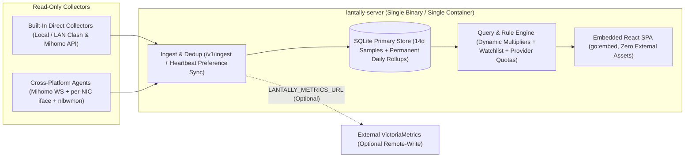

<div align="center">

# LanTally

**Privacy-First, Self-Hosted Multi-Dimensional Network & Proxy Traffic Ledger**

[](https://github.com/misakayyds/lantally/actions/workflows/ci.yml)
[](https://github.com/misakayyds/lantally/releases)
[](https://github.com/misakayyds/lantally/pkgs/container/lantally)
[](go.mod)
[](LICENSE)

**English** · [简体中文](README.zh-CN.md) · [Operations Guide](docs/operations.md) · [ADRs](docs/adr/)

</div>

---

**LanTally** is a strictly **read-only, self-hosted traffic accounting and billing reconciliation platform** for home gateways,旁路由 (side-routers), and personal workstations. Connect local or LAN Clash / Mihomo (and `clash_api`-enabled sing-box) controllers **agentlessly via built-in Direct Collectors**, or deploy lightweight static **Agents** across OpenWrt, Linux, macOS, and Windows with a one-time claim code.

> [!IMPORTANT]
> **Observe & reconcile only—zero network mutations**: LanTally never modifies routes, firewall rules, DHCP, or proxy policies, and contains no remote command execution channel. All traffic ledgers stay on your own volume.


---

## Why LanTally?

Running OpenClash, Mihomo, Clash Verge, Nikki, or sing-box in daily life usually leaves four gaps:

1. **Ephemeral dashboard counters**: Proxy dashboards reset whenever the core restarts or updates subscriptions, wiping out multi-day and billing-cycle history.
2. **Complex node multipliers**: Mixing `0.2x` off-peak nodes, `1x` standard lines, `2x` IEPL relays, and `3x` residential exits makes raw byte totals meaningless for billing—and adding rules later is useless if historical usage cannot be recalculated retroactively.
3. **No custom traffic slicing**: Tracking how much traffic a specific slice consumes—such as an `AI` policy group, streaming traffic, a `wg0` / `Tailscale` tunnel interface, a desktop process, or a specific domain—is either impossible or double-counted across virtual NICs.
4. **Multiple provider subscriptions**: When using multiple proxy providers alongside self-hosted VPS nodes, comparing local weighted usage against provider-reported quotas and reset days requires tedious manual math.

LanTally turns those scattered counters into one **accurate, retroactive, auditable local ledger**.

---

## Feature Highlights

### 1. Dual-Mode Onboarding: Agentless Direct Collectors + Lightweight Agents

Both modes feed the same deduplicated ledger pipeline and can be mixed freely:

| Mode | Best For | Collected Signals | Setup Experience |
| --- | --- | --- | --- |
| **Direct Collectors (`direct_collectors`)** | Local desktop proxy clients or LAN-reachable gateways (e.g., OpenClash / Nikki) | WebSocket `/connections` 1s streaming (with HTTP polling fallback), `/proxies` node catalog, `/providers/proxies` subscription quotas | **Zero install**: Enter `http://<IP>:9090` + optional Secret in the **Nodes** UI; secrets are encrypted at rest with AES-256-GCM and masked everywhere |
| **Lightweight Agent (`lantally-agent`)** | Remote gateways, per-NIC hardware/virtual interface accounting, or OpenWrt `nlbwmon` host totals | Clash/Mihomo streaming + pure-Go cross-platform `iface` (Linux / Windows / macOS) + OpenWrt `nlbwmon` | **One-liner**: Generate a 10-minute one-time claim code in the UI and run a single `install.sh` / `install.ps1` command |

- **Accurate short-connection accounting**: Only the initial startup snapshot sets a baseline; every subsequent connection ID counts from `0` in full, and normal connection closes never trigger false `collector_reset` alerts.
- **Per-NIC tracking without double counting**: Individual physical and virtual NICs (`eth0`, `wlan0`, `wg0`, `tun0`, `Tailscale`) are stored for per-interface inspection and Watchlist rules, while loopback/tunnel/container virtual NICs are automatically excluded from node-level `total`.

### 2. Multi-Dimensional `RX` / `TX` Ledgers & Flexible Time Windows

Every summary card, ranking table, and stacked bar chart tracks **Download (`RX`)**, **Upload (`TX`)**, and **Total** independently:

- **7 Analytical Dimensions**:
  - **Real Exit Nodes (`chains[0]`)**: Resolves the actual terminal proxy exit node or `DIRECT` route rather than the outer selector group
  - **Top-Level Strategy Groups (`chains[len-1]`)**: Breaks down usage by policy groups such as `AI`, `Streaming`, `Telegram`, `Google`, or `Gaming`
  - **Apps & Processes (`metadata.process`)**: Extracts executable basenames (e.g., `chrome.exe`, `Cursor`, `Telegram`, stripping local directory paths)
  - **Registered Domains (`eTLD+1`, opt-in)**: Disabled by default; when enabled per node, collapses noisy CDN subdomains into `eTLD+1` (e.g., `googlevideo.com`, `openai.com`) capped to periodic Top N
  - **LAN Devices**: Correlates `nlbwmon`, ARP/neighbor observations, and LAN Mihomo `sourceIP` evidence with UI rename, manual merge, and unmerge support
  - **Network Interfaces (`iface`)**: Pure-Go counters on Linux (`/proc/net/dev`), Windows (`GetIfTable2Ex`), and macOS (`NET_RT_IFLIST2`)
  - **Multi-Site / Multi-Node Rollups**: Unified view across gateways, NAS boxes, and workstations
- **7 Time Ranges**: **`Today` (from local midnight)**, **`24h`**, **`72h`**, **`7d`**, **`30d`**, **`Billing Cycle` (aligned to reset day)**, and **`Custom Date Range`**—backed by 14-day granular samples and permanent daily rollups in SQLite.

### 3. Dynamic Retroactive Multiplier Engine

- **4 Rule Match Types (evaluated by priority)**:
  - `exact`: Exact outbound node name match
  - `keyword`: Substring match (e.g., `IEPL` → `2.0x`, `Residential` → `3.0x`, `OffPeak` → `0.2x`)
  - `regex`: Full regular expression matching
  - `auto_extract`: Automatically parses multiplier tokens embedded in node names (`x2`, `1.5x`, `×3`, `[0.5x]`, `倍率1.5`, `0.2倍`)
- **Instant Retroactive Recalculation**: Raw proxied bytes (`proxy_raw`) are stored per outbound. Adding, editing, toggling, or importing rules **immediately recalculates historical curves, totals, and billing comparisons** without waiting for future traffic.
- **`Default 1x` Fallback & Badges**: Unmatched proxy exits count at `1.0x` by default and display a clear **`Default 1x`** badge so unconfigured high-multiplier nodes are easy to spot.
- **Live Node Preview & JSON Rule Packs**: Preview rule matches live against the synced `/proxies` catalog and import/export portable JSON rule packs:

```json
[
  { "name": "Residential 3x", "match_type": "keyword", "pattern": "Residential", "factor": 3.0, "priority": 300, "enabled": true },
  { "name": "IEPL 2x", "match_type": "keyword", "pattern": "IEPL", "factor": 2.0, "priority": 200, "enabled": true },
  { "name": "Auto-extract node multiplier", "match_type": "auto_extract", "pattern": "", "factor": 1.0, "priority": 100, "enabled": true }
]
```

### 4. Custom Watchlist & Quota Cards

Track any custom traffic slice on the **Watchlist** page:

- **Cross-dimensional matchers**: Combine `node`, `iface` (e.g., `wg0`, `tun0`), `outbound`, `group` (e.g., `AI`, `Streaming`), `process`, `domain`, or `device` rules using exact, keyword, or regex filters.
- **Immediate historical trend curves**: Watch items aggregate over stored dimensional series on the fly—historical `RX`/`TX` bars appear as soon as an item is saved, with one-click **Overview pinning**.
- **Override multipliers & `MB / GB / TB` quotas**: Optionally assign a custom multiplier override, monthly reset day (`1–28`), and `MB` / `GB` / `TB` quota with visual progress bars.

### 5. Multi-Provider Subscription Reconciliation & Alerts

- **Automatic Mihomo Provider sync**: Reads `subscriptionInfo` (`Upload`, `Download`, `Total`, `Expire`) from Mihomo `/providers/proxies` for `HTTP` providers, filtering out redundant `Compatible` groups and deduplicating shared upstream subscriptions to compare local weighted usage against provider counters.
- **Human-friendly manual plans**: Add manual multi-provider quotas in **`MB` / `GB` / `TB`** (no raw byte math required) when a provider omits `subscription-userinfo` headers.
- **Built-in anomaly alerts**: Flags **Node Silence**, **Counter Resets**, **Daily Traffic Spikes**, and **>10% Billing Drift**, with one-click acknowledgement.

### 6. Offline-Ready Bilingual Embedded Web UI

Built with **Vite 6 + React 19 + TypeScript** and embedded into `lantally-server` via `go:embed`:

- **Zero external font or CDN requests**: Loads instantaneously in air-gapped or strictly private LANs.
- **7 Dedicated Views (`zh-CN` / `en`)**: **Overview**, **Proxy & Multipliers**, **Watchlist**, **Apps & Domains**, **Devices & Interfaces**, **Nodes**, and **Alerts & Settings**.

---

## Architecture



---

## Quick Start

### Option 1: Single Docker Container (Recommended)

```bash
docker run -d \
  --name lantally \
  --restart unless-stopped \
  -p 8080:8080 \
  -v lantally:/var/lib/lantally \
  ghcr.io/misakayyds/lantally:latest
```

> [!TIP]
> **LAN `NO_PROXY` tip**: If your Docker host sets global `HTTP_PROXY` / `HTTPS_PROXY` variables, add `-e NO_PROXY=127.0.0.1,localhost,192.168.0.0/16,10.0.0.0/8,172.16.0.0/12` so Direct Collector requests to LAN gateways bypass upstream proxies.

Want to explore the UI with synthetic `TEST-NET` data first? Pass `-e LANTALLY_DEMO=1`:

```bash
docker run -d --name lantally -p 8080:8080 -e LANTALLY_DEMO=1 -v lantally:/var/lib/lantally ghcr.io/misakayyds/lantally:latest
```

### Option 2: Docker Compose

```bash
git clone https://github.com/misakayyds/lantally.git
cd lantally
docker compose -f deploy/docker/compose.yaml up -d --build
```

### First-Run Setup (Under 2 Minutes)

1. Open `http://<host>:8080` and set an admin password (minimum 8 characters) in the setup wizard.
2. Navigate to **Nodes**:
   - **Agentless LAN / Local Mihomo**: Click **Add Direct Collector**, enter your Clash/Mihomo External Controller URL (e.g., `http://192.168.1.2:9090`) and optional Secret, click **Test**, and save.
   - **Remote Gateways / Per-NIC & `nlbwmon` Hosts**: Click **Add Agent Node**, generate a one-time claim code, and run the generated one-line command on the target machine.

---

## Common Workflows

1. **Enabling Domain Ranking (opt-in)**: Domain collection (`collect_domains`) is `OFF` by default for privacy. Open **Nodes**, scroll to **Registered Nodes**, and click the **`OFF`** button in the **Domains** column to toggle it **`ON`** (or edit a Direct Collector and check **Collect Domains (opt-in)**). Agents pick up the change automatically via `/v1/ingest` heartbeats without editing `agent.json`.
2. **Importing & Previewing Multiplier Rules**: Open **Proxy** → **Multiplier Rules** to add `exact`, `keyword`, `regex`, or `auto_extract` rules, import/export JSON rule packs, and click **Preview** to inspect live matches across all synced proxy nodes.
3. **Creating Custom Watchlist Cards**: Open **Watchlist** → **New Watch Item** to combine interface, group, app, domain, exit node, or device filters, pin the card to **Overview**, and attach optional override multipliers and `MB / GB / TB` quotas.

---

## Configuration Reference

### `lantally-server` CLI Flags

| Flag | Default | Description |
| --- | --- | --- |
| `-listen` | `0.0.0.0:8080` | HTTP listen address for Web UI and APIs |
| `-db` | `/var/lib/lantally/meta/lantally.db` | SQLite database file path |
| `-demo` | `false` | Seed synthetic `TEST-NET` traffic on startup |
| `-version` | `false` | Print version, commit, and build timestamp |

### Environment Variables

| Variable | Description |
| --- | --- |
| `LANTALLY_BOOTSTRAP_ADMIN_PASSWORD` | Optional initial admin password applied when no admin credential exists yet |
| `LANTALLY_SECRET_KEY` | Optional passphrase deriving the 32-byte AES-256-GCM key via HKDF-SHA256 for `direct_collectors` secrets (overrides `<db>.key`) |
| `LANTALLY_METRICS_URL` | Optional external VictoriaMetrics base URL (e.g., `http://vm.lan:8428`) for bounded 5-label Prometheus remote-write |
| `LANTALLY_AGENT_DIR` | Directory serving downloadable agent binaries at `/agents/{os}/{arch}` (default `/usr/share/lantally/agents`) |
| `LANTALLY_DEMO` | Set to `1` to seed synthetic preview data (equivalent to `-demo`) |
| `NO_PROXY` | Recommended when host proxy env vars are set alongside LAN Direct Collectors |

> [!WARNING]
> **Backup key reminder**: Downloading `lantally.db` via **Settings** backs up SQLite only. If you use Direct Collectors with secrets, also back up `/var/lib/lantally/meta/lantally.db.key` (or preserve `LANTALLY_SECRET_KEY`) so encrypted credentials remain decryptable upon restore. See [`docs/operations.md`](docs/operations.md).

---

## Multi-Architecture Agent Matrix

Every tagged release publishes `CGO_ENABLED=0` static binaries, `SHA256SUMS`, and an SPDX SBOM (also hosted inside the container at `/agents/{os}/{arch}`):

| OS | Arch | Release Binary | Typical Target |
| --- | --- | --- | --- |
| **Linux / OpenWrt** | `amd64` | `lantally-agent_linux_amd64` | x86_64 gateways, NAS, Debian/Ubuntu hosts |
| **Linux / OpenWrt** | `arm64` | `lantally-agent_linux_arm64` | ARMv8 routers/SBCs (NanoPi R2S/R4S/R5S, Raspberry Pi) |
| **Linux / OpenWrt** | `armv7` | `lantally-agent_linux_armv7` | 32-bit ARM routers (served at `/agents/linux/arm`) |
| **OpenWrt** | `mips` / `mipsle` | `lantally-agent_linux_mips*_softfloat` | MT7621 / AR71xx softfloat routers (`tmpfs`-backed, zero flash wear) |
| **macOS** | `arm64` / `amd64` | `lantally-agent_darwin_*` | Apple Silicon & Intel Macs (`launchd` service) |
| **Windows** | `amd64` / `arm64` | `lantally-agent_windows_*.exe` | Windows 10/11 desktops & laptops (Scheduled Task) |

---

## Development & Verification

Prerequisites: **Go 1.26+** and **Node.js 22+**.

```bash
# 1. Type-check and build embedded Web UI into web/dist
cd web
npm ci
npx tsc --noEmit
npm run build
cd ..

# 2. Run unit & integration tests
go test -count=1 ./...
go vet ./...

# 3. Run opaque-box E2E suite (214 subtests across Tiers 1-5)
go test -count=1 -tags e2e -timeout 180s ./test/e2e/...

# 4. Run local preview server with synthetic data
go run ./cmd/lantally-server -listen 127.0.0.1:8080 -db ./data/lantally.db -demo
```

---

## Documentation

- Operations (deployment, flags/env, backup & key restore, upgrade, rollback, HTTPS): [`docs/operations.md`](docs/operations.md)
- 7-day field reconciliation template: [`docs/reconciliation-v0.1.md`](docs/reconciliation-v0.1.md)
- System design & ADRs (`0001`–`0007`): [`docs/superpowers/specs/2026-08-18-lantally-design.md`](docs/superpowers/specs/2026-08-18-lantally-design.md) · [`docs/adr/`](docs/adr/)

## License

Licensed under the [Apache License 2.0](LICENSE).
