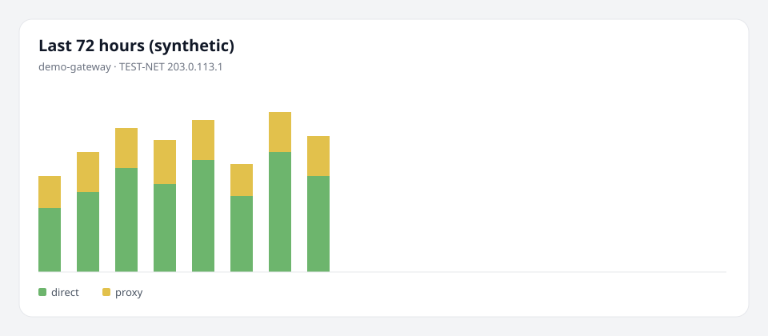

# LanTally

**English** | [简体中文](README.zh-CN.md)

LanTally is a privacy-first, self-hosted traffic ledger for home and small networks. It collects usage either agentlessly via built-in **Direct Collectors** subscribing read-only to local/LAN Clash or Mihomo APIs, or via lightweight outbound-only **agents**, splitting direct vs. proxied `RX` / `TX` traffic, applying dynamic retroactive multiplier rules, tracking custom watchlists, and reconciling usage against multi-provider subscriptions.

It only observes. It never changes routing, firewall rules, DHCP, or proxy policies.

> v0.2.0 · https://github.com/misakayyds/lantally · image `ghcr.io/misakayyds/lantally:latest`

## Three steps

**1. Run one container**

```bash
docker run -d --name lantally \
  -p 8080:8080 \
  -v lantally:/var/lib/lantally \
  ghcr.io/misakayyds/lantally:latest
```

From this repo: `docker compose -f deploy/docker/compose.yaml up --build`

> **LAN Direct Collector note:** If your Docker host or environment sets `HTTP_PROXY` / `HTTPS_PROXY`, pass `-e NO_PROXY=127.0.0.1,localhost,192.168.0.0/16,10.0.0.0/8,172.16.0.0/12` so LAN Mihomo API requests bypass upstream proxies.

The container runs `lantally-server` with SQLite (`/var/lib/lantally/meta/lantally.db`) as the primary store and an embedded offline-ready Vite + React + TypeScript Web UI (zero external CDNs or fonts). Optional external VictoriaMetrics push is supported via `LANTALLY_METRICS_URL`.

Preview with synthetic charts (`TEST-NET` synthetic data only):

```bash
docker run -d --name lantally -p 8080:8080 -e LANTALLY_DEMO=1 -v lantally:/var/lib/lantally ghcr.io/misakayyds/lantally:latest
```

**2. Set the admin password** in the first-run wizard at `http://<host>:8080` (or pass `LANTALLY_BOOTSTRAP_ADMIN_PASSWORD`).

**3. Connect traffic sources** in the **Nodes** page:

- **Direct Collectors (agentless):** Add a read-only Clash/Mihomo External Controller URL (e.g. `http://203.0.113.20:9090`) and optional secret; secrets are encrypted at rest with AES-256-GCM and masked across the UI, API, and backups.
- **Lightweight Agents:** Copy the one-line claim command (`install.sh` / `install.ps1` / OpenWrt) and run it on a gateway or host. Agents stream Mihomo `/connections` over WebSocket (falling back to HTTP polling when unsupported) alongside cross-platform per-NIC `iface` and OpenWrt `nlbwmon` counters.



Public deployments must sit behind HTTPS. If the GHCR tag is not published yet, build locally with compose; pushing a `v0.2.0` tag triggers the multi-arch image and agent release workflow.

## What you get

- **Multi-dimensional `RX` / `TX` ledger:** Per-device, per-node, real exit nodes (`chains[0]`), top-level strategy groups (`chains[len-1]`), apps/processes (`metadata.process`), per-interface (`iface`, excluding loopback/tunnel virtual NICs from node `total` to prevent double counting), and opt-in `eTLD+1` domains
- **Flexible time filters:** `Today` / `24h` / `72h` / `7d` / `30d` / `Billing cycle` / `Custom date range` (14-day granular samples; permanent daily rollups)
- **Dynamic retroactive multipliers:** `exact`, `keyword`, `regex`, and numeric `auto_extract` (`2x`, `1.5x`, `0.5倍`) with priority ordering, JSON import/export, and live node preview; rule changes immediately recalculate historical totals and billing comparisons from `proxy_raw`, marking unmatched nodes as `Default 1x`
- **Custom Watchlist:** Combine node, interface (e.g. `wg0`, `tun0`), exit node, strategy group, process, domain, or device filters into standalone cards with historical trend curves, Overview pinning, optional override multipliers, and `MB / GB / TB` quota/reset-day tracking
- **Multi-provider reconciliation & alerts:** Auto-sync Mihomo `/providers/proxies` subscription usage, quotas, and expiry (with manual `MB / GB / TB` multi-plan fallback), plus alerts for >10% billing drift, node silence, counter resets, and traffic spikes
- **Embedded 7-view bilingual Web UI:** `zh-CN` / `en` SPA (`Overview`, `Proxy`, `Watchlist`, `Apps`, `Devices`, `Nodes`, `Alerts` & `Settings`) with zero external font/CDN dependencies

## Quick usage tips

- **Enabling Domain Ranking (opt-in):** Domain collection (`collect_domains`) is `OFF` by default for privacy. Open **Nodes**, scroll to **Registered Nodes**, and click the `OFF` chip in the **Domains** column to toggle it `ON` (or click **Edit** on a Direct Collector and check **Collect Domains (opt-in)**). Changes take effect immediately—agents sync the toggle automatically via `/v1/ingest` heartbeats without editing `agent.json`—recording `eTLD+1` domains capped to periodic Top N.
- **Configuring multiplier rules:** In **Proxy** → **Multiplier Rules**, add keyword/regex rules (e.g. `IEPL` → `2`) or enable numeric `auto_extract`, preview live matches against synced proxy nodes, or import/export rule packs as JSON.
- **Tracking custom traffic slices or quotas:** In **Watchlist** → **New Watch Item**, pick any combination of interfaces, strategy groups, apps, domains, or exit nodes and optionally attach an override multiplier and `GB` / `TB` monthly quota.

## Safety & privacy boundaries

- Read-only observation only: no remote command execution, traffic blocking, rate limiting, routing edits, or firewall/proxy policy writes
- Full URLs and paths are never collected; domain collection is disabled by default and stores only `eTLD+1` + bounded Top N when explicitly enabled per node or matched by a domain watch rule
- Optional VictoriaMetrics remote-write enforces a strict 5-label whitelist (`site_id`, `node_id`, `device_id`, `class`, `direction`)
- Reconciled estimates never overwrite raw byte counters

## Install agents & build locally

GitHub Releases attach checksums (`SHA256SUMS`), an SPDX SBOM, and static binaries for `linux/amd64`, `linux/arm64`, `linux/armv7`, `linux/mips` & `linux/mipsle` (softfloat), `darwin/amd64` & `darwin/arm64`, and `windows/amd64` & `windows/arm64`. The container serves these binaries at `/agents/{os}/{arch}` (with 32-bit ARM at `/agents/linux/arm`), and `deploy/openwrt/` provides tmpfs-backed OpenWrt init files to avoid persistent flash writes.

Local development and verification:

```bash
# Build embedded frontend assets
cd web && npm ci && npm run build && cd ..

# Run unit/integration and E2E test suites
go test ./...
go test -tags e2e ./test/e2e/...
```

## Docs

- Operations (container, flags/env, DB & secret key backup/restore, upgrade, HTTPS): [`docs/operations.md`](docs/operations.md)
- Field reconciliation log: [`docs/reconciliation-v0.1.md`](docs/reconciliation-v0.1.md)
- Design and ADRs (0001–0007): [`docs/superpowers/specs/2026-08-18-lantally-design.md`](docs/superpowers/specs/2026-08-18-lantally-design.md), [`docs/adr/`](docs/adr/)

## License

Apache License 2.0. See [`LICENSE`](LICENSE).
