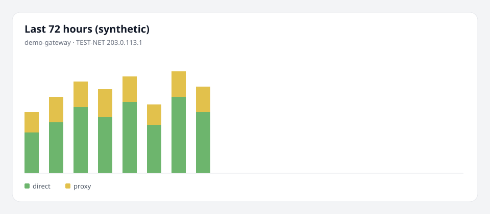

# LanTally

[English](README.md) | **简体中文**

LanTally 是面向家庭与小型网络的**隐私优先自托管流量账本**：支持免装客户端的服务端**直连采集器（Direct Collectors）**只读订阅本地或局域网 Clash/Mihomo API，也支持轻量级**上报 Agent**；系统按 `RX` / `TX` 区分直连与代理流量，支持关键词/正则动态倍率回溯重算、自定义关注项看板与多机场套餐配额自动对账。

它只观察、记账、对账，**不改你的网络路由、不限速、不改代理策略、不远程执行命令**。

> v0.2.0 · https://github.com/misakayyds/lantally · 镜像 `ghcr.io/misakayyds/lantally:latest`

## 三步上手

**1. 跑一个容器**

```bash
docker run -d --name lantally \
  -p 8080:8080 \
  -v lantally:/var/lib/lantally \
  ghcr.io/misakayyds/lantally:latest
```

本仓库构建：`docker compose -f deploy/docker/compose.yaml up --build`

> **内网直采提示**：若宿主机或容器环境配置了 `HTTP_PROXY` / `HTTPS_PROXY`，在直连局域网网关 Mihomo API 时请加上 `-e NO_PROXY=127.0.0.1,localhost,192.168.0.0/16,10.0.0.0/8,172.16.0.0/12`，避免局域网请求误走上游代理。

容器默认直接运行 `lantally-server`，以内置 SQLite（`/var/lib/lantally/meta/lantally.db`）为主存储，并内嵌离线可用的 Vite + React + TypeScript Web UI（零外部字体或 CDN 请求）；如需外接 VictoriaMetrics，可通过 `LANTALLY_METRICS_URL` 可选推送。

只想预览界面、不接真实网关时可开启合成演示数据（仅 `TEST-NET` 合成流量）：

```bash
docker run -d --name lantally -p 8080:8080 -e LANTALLY_DEMO=1 -v lantally:/var/lib/lantally ghcr.io/misakayyds/lantally:latest
```

**2. 打开** `http://<主机>:8080`，按首次向导设置管理员密码（或通过 `LANTALLY_BOOTSTRAP_ADMIN_PASSWORD` 预设）。

**3. 接入流量数据源**（在「**节点**」页面二选一或混用）：

- **直连采集器（免装 Agent）：** 在「节点」页直接填写本机或局域网 Clash/Mihomo External Controller 地址（如 `http://203.0.113.20:9090`）与 Secret 即可只读订阅；密钥使用 AES-256-GCM 静态加密存储并在界面与备份中脱敏。
- **轻量 Agent：** 点击「添加节点」复制一次性领取码安装命令（`install.sh` / `install.ps1` / OpenWrt）在网关或主机执行。Agent 优先使用 WebSocket `/connections` 实时流（不支持时自动降级 HTTP 轮询），同时采集跨平台单网卡（`iface`）与 OpenWrt `nlbwmon` 数据。



公网部署必须置于 HTTPS 反向代理之后。若 GHCR 镜像尚未推送，可先使用 compose 本地构建；推送 `v0.2.0` tag 后，Release 流水线会自动发布多架构镜像与客户端二进制。

## 核心功能

- **多维度 `RX` / `TX` 账本：** 按设备、节点、真实落地出口（`chains[0]`）、顶层策略组（`chains[len-1]`）、应用进程（`metadata.process`）、单网卡（`iface`，自动将回环与隧道虚拟口排除出节点 `total` 防止翻倍）以及按需开启的 `eTLD+1` 域名统计上下行与总流量
- **灵活时间范围：** 支持 `今天 / 24h / 72h / 7d / 30d / 本账期 / 自定义日期`（细粒度采样保留 14 天，日聚合永久保留）
- **动态回溯倍率引擎：** 支持 `精确匹配`、`关键词`、`正则` 与 `自动提取`（识别节点名中的 `2x`、`1.5x`、`0.5倍` 等），支持优先级排序、JSON 批量导入/导出与节点命中实时预览；修改规则后**所有历史曲线与账单对账基于 `proxy_raw` 即时回溯重算**，未命中规则的节点默认按 `1.0x` 计入并标注「`默认 1x`」
- **自定义关注项（Watchlist）：** 从节点、网卡（如 `wg0`、`tun0`）、出口、策略组、进程、域名、设备维度自由组合筛选条件，生成独立历史趋势卡片（可置顶至概览页），并支持绑定独立覆盖倍率与 `MB / GB / TB` 周期配额及每月重置日
- **多机场套餐自动对账与告警：** 自动同步 Mihomo `/providers/proxies` 订阅已用流量、总额度与到期时间（同时支持 `MB / GB / TB` 手动多套餐录入兜底），提供节点静默、计数器重置、流量突增与 >10% 账单偏差告警
- **内嵌 7 视图双语工作台：** 支持中英文切换（概览 / 代理 / 关注 / 应用 / 设备 / 节点 / 告警与设置），纯内网离线秒开

## 常见操作指南

- **如何开启域名排行（默认关闭）：** 为保护隐私，所有节点的域名采集（`collect_domains`）默认为 `OFF`。前往 **「节点」** 页面，在下方的 **「上报节点」** 表格中直接点击对应节点最后一列的 `OFF` 按钮切换为 `ON`（或在上方「直连采集器」点击「编辑」，勾选「开启域名采集 (opt-in)」后保存）。开启后秒级热生效（Agent 节点通过 `/v1/ingest` 心跳自动同步开关，无需手改 `agent.json`），新连接会自动归并为主域名（`eTLD+1`）并按周期 Top N 收敛记录。
- **如何配置倍率规则：** 进入 **「代理」** 页面 →「倍率规则」，添加关键词（如 `IEPL` -> `2`）或开启节点名倍率自动提取，点击「预览匹配」可实时核对所有已同步节点的生效倍率，支持一键导出/导入规则 JSON。
- **如何单独追踪某类流量或套餐包：** 进入 **「关注」** 页面 →「新建关注项」，选择想要圈定的网卡、策略组、进程、域名或出口节点组合，按需填写每月重置日与 `GB` / `TB` 配额即可。

## 安全与隐私边界

- 严格只读观察：无远程命令执行、无流量阻断或限速、无路由/防火墙/代理策略写入
- 绝不记录完整 URL 或完整访问路径；域名采集默认关闭，显式开启或配置域名关注项后仅记录 `eTLD+1` 与受控 Top N
- 可选 VictoriaMetrics 远程写入严格限制 5 个白名单标签（`site_id`、`node_id`、`device_id`、`class`、`direction`）
- 服务商未公开计费规则时，对账差异仅作提示与告警，绝不篡改本地原始字节账本

## 从 Release 安装 Agent 与本地构建

GitHub Release 提供校验和（`SHA256SUMS`）、SPDX SBOM，以及 `linux/amd64`、`linux/arm64`、`linux/armv7`、`linux/mips`/`mipsle`（softfloat）、`darwin/amd64`+`arm64`、`windows/amd64`+`arm64` 的静态编译 Agent。容器内同样在 `/agents/{os}/{arch}` 托管这些二进制（32 位 ARM 位于 `/agents/linux/arm`），`deploy/openwrt/` 提供基于 tmpfs 的 OpenWrt 运行配置以避免频繁写闪存。

本地开发与验证：

```bash
# 构建内嵌前端
cd web && npm ci && npm run build && cd ..

# 运行单元/集成测试与端到端测试
go test ./...
go test -tags e2e ./test/e2e/...
```

## 文档

- 运维指南（容器、参数与环境变量、数据库与密钥备份恢复、升级、HTTPS）：[`docs/operations.md`](docs/operations.md)
- 对账实测模板：[`docs/reconciliation-v0.1.md`](docs/reconciliation-v0.1.md)
- 设计与架构决策记录（ADR 0001–0007）：[`docs/superpowers/specs/2026-08-18-lantally-design.md`](docs/superpowers/specs/2026-08-18-lantally-design.md)、[`docs/adr/`](docs/adr/)

## 许可证

[Apache License 2.0](LICENSE)
