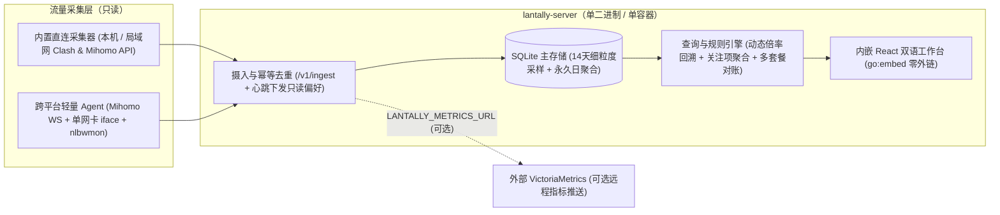

<div align="center">

# LanTally

**隐私优先的自托管多维网络与代理流量账本**

[](https://github.com/misakayyds/lantally/actions/workflows/ci.yml)
[](https://github.com/misakayyds/lantally/releases)
[](https://github.com/misakayyds/lantally/pkgs/container/lantally)
[](go.mod)
[](LICENSE)

[English](README.md) · **简体中文** · [运维文档](docs/operations.md) · [架构决策 (ADR)](docs/adr/)

</div>

---

**LanTally** 是一款面向家庭网关、旁路由与个人桌面的**纯只读自托管流量统计与对账应用**。它既支持在服务端**免装客户端直连（Direct Collectors）**本机或局域网的 Clash / Mihomo（及开启 `clash_api` 的 sing-box），也支持通过一次性领取码在 OpenWrt / Linux / macOS / Windows 上一键部署轻量上报 Agent。

> [!IMPORTANT]
> **只观察、只记账、不对网路做任何写操作**：LanTally 绝不修改路由表、不碰防火墙、不改代理策略、不支持远程执行命令，所有流量数据留在你自己的容器或硬盘里。


---

## 为什么做 LanTally？

日常使用 OpenClash / Mihomo / Clash Verge / Nikki / sing-box 时，往往会遇到这几个痛点：

1. **重启即清空，看不清长周期趋势**：代理面板只看得到实时连接或当次启动累计，内核一重启或更新订阅，过去几天、本账期的流量去向就无从查起。
2. **节点倍率五花八门，手算账单极麻烦**：`0.2x` 闲时下载、`1x` 普通线路、`2x` IEPL、`3x` 家宽混用时，原始字节数根本不等于套餐扣费；事后补填倍率如果不能回溯重算历史，账单永远对不上。
3. **想单独盯紧某几类流量却没法切片**：想单独看「`AI` 分流组」「流媒体」「`wg0` / `Tailscale` 虚拟网卡」「某个桌面软件」或「特定网站域名」跑了多少流量、占了多少配额，传统工具要么颗粒度太粗，要么把无关数据混加翻倍。
4. **多机场订阅并存，缺乏自动对账**：手里同时有主力机场、按量备用机场和自建节点时，很难直观看到每个套餐的剩余额度、重置倒计时，以及本地折算消耗与机场侧计数的偏差。

LanTally 就是为了把这几件事**收成一本清晰、可回溯、可对账的本地流量账**。

---

## 核心功能全景

### 1. 双模式无感接入：免装直采 + 跨平台轻量 Agent

两种模式写入同一套幂等账本，可单独使用也可多节点混用：

| 接入方式 | 适用场景 | 采集能力 | 部署体验 |
| --- | --- | --- | --- |
| **直连采集器 (`Direct Collectors`)** | 本机代理客户端，或同局域网可达的软路由 / 旁路由（如 OpenClash、Nikki） | WebSocket `/connections` 1 秒级流式追踪（自动降级 HTTP 轮询）、`/proxies` 节点目录、`/providers/proxies` 订阅配额 | **零安装**：直接在网页「节点」页填入 `http://<IP>:9090` 与 Secret 即可；密钥经 AES-256-GCM 静态加密存储，界面与备份全程脱敏 |
| **轻量上报 Agent (`lantally-agent`)** | 跨网段网关、需要统计物理/虚拟单网卡流量或 OpenWrt `nlbwmon` 设备总量的主机 | Clash/Mihomo 流式采集 + 纯 Go 跨平台单网卡（Linux / Windows / macOS）+ OpenWrt `nlbwmon` | **一条命令**：网页生成 10 分钟有效的一次性领取码，复制单行 `install.sh` / `install.ps1` 自动完成下载、换取 Token 与开机自启 |

- **精准基线，不漏短连接**：仅在采集器启动首帧建立已存连接基线，后续新出现的连接从 `0` 全额累计字节；连接正常关闭自动回收状态，不会误报计数器重置。
- **物理与虚拟网卡智能防重**：单网卡维度完整保留 `eth0`、`wlan0`、`wg0`、`tun0`、`Tailscale` 等独立流量供查询与关注，而计算节点级 `total` 时自动剔除回环与隧道/容器虚拟口，杜绝总量翻倍。

### 2. 多维度 `RX` / `TX` 细粒度账本与灵活时间窗

所有统计卡片、排行表与堆叠柱状图均独立记录并展示 **下载（`RX`）**、**上传（`TX`）** 与 **总计（`Total`）**：

- **7 大分析维度**：
  - **真实落地出口（`chains[0]`）**：精准剥离策略组外壳，定位实际消耗流量的落地代理节点与直连（`DIRECT`）分流
  - **顶层策略组（`chains[len-1]`）**：一眼看清 `AI`、`流媒体`、`Telegram`、`Google`、`游戏` 等业务分流组的耗流占比
  - **应用与进程（`metadata.process`）**：桌面端自动提取可执行文件名（如 `chrome.exe`、`Cursor`、`Telegram`，剥离本地隐私路径）统计应用排行
  - **目标主域名（`eTLD+1`，默认关闭）**：按节点按需开启后，自动将海量随机 CDN 子域名归并为主域名（如 `googlevideo.com`、`openai.com`）并按周期 Top N 收敛存储，排查偷跑流量的元凶
  - **局域网设备**：融合 `nlbwmon`、ARP/邻居表与 Mihomo 局域网 `sourceIP` 证据，支持网页端改备注名、手动合并与一键拆分设备身份
  - **单网卡接口（`iface`）**：跨 Linux（`/proc/net/dev`）、Windows（`GetIfTable2Ex`）、macOS（`NET_RT_IFLIST2`）查看每块物理或虚拟网卡流量
  - **多站点 / 多节点汇总**：多台网关、NAS 与桌面电脑统一汇聚展示
- **7 种时间窗口**：支持 **`今天`（自然日 00:00 起）**、**`24h`**、**`72h`**、**`7d`**、**`30d`**、**`本账期`（自动对齐套餐重置日）** 以及 **`自定义起止日期`**；底层自动保存 14 天细粒度采样与永久日聚合账本。

### 3. 动态回溯倍率引擎（改规则历史立即生效）

告别「逐行手填倍率」和「改完只对以后生效」的繁琐体验：

- **4 类匹配模式（按优先级从高到低匹配）**：
  - `精确匹配 (exact)`：针对特定节点名精确指定倍率
  - `关键词 (keyword)`：如节点名包含 `IEPL` → `2.0x`、包含 `家宽` → `3.0x`、包含 `闲时` → `0.2x`
  - `正则表达式 (regex)`：灵活匹配复杂命名规范
  - `节点名自动提取 (auto_extract)`：自动从节点名中识别常见倍率写法（如 `x2`、`1.5x`、`×3`、`[0.5x]`、`倍率1.5`、`0.2倍`）
- **基于 `proxy_raw` 实时回溯重算**：数据库始终按出口节点忠实保存原始代理字节（`proxy_raw`）。无论何时新增、修改、启停或导入倍率规则，**过去 24 小时、本账期乃至历史月度的折算曲线与账单总额都会立即重新计算**。
- **默认 `1.0x` 兜底与透明标注**：未命中任何规则的代理出口默认按 `1.0x` 计入折算总量，并在表格中清晰打上 **`默认 1x`** 标记，既不漏算账单，又方便发现漏配规则的高倍节点。
- **实时预览与 JSON 规则集导入/导出**：编辑规则时可直接对照从 Mihomo `/proxies` 同步的全部节点列表实时预览命中结果，并支持一键导入/导出 JSON 规则包：

```json
[
  { "name": "家宽专线 3x", "match_type": "keyword", "pattern": "家宽", "factor": 3.0, "priority": 300, "enabled": true },
  { "name": "IEPL 2x", "match_type": "keyword", "pattern": "IEPL", "factor": 2.0, "priority": 200, "enabled": true },
  { "name": "自动提取节点名倍率", "match_type": "auto_extract", "pattern": "", "factor": 1.0, "priority": 100, "enabled": true }
]
```

### 4. 自定义关注项看板（Watchlist）

想把任何你关心的流量单独拉出来重点盯防？在 **「关注」** 页面新建一个关注项即可：

- **跨维度自由圈选**：支持按 `节点`、`网卡（如 wg0 / tun0）`、`落地出口`、`策略组（如 AI / Streaming）`、`应用进程`、`域名`、`设备` 设置精确值、关键词或正则组合。
- **建好即看历史曲线**：基于已采维度时序实时聚合，新建关注项后无需干等，立即呈现历史上下行趋势柱状图与汇总卡片，并支持一键**置顶到「概览」首页**。
- **专属覆盖倍率与流量包配额**：可为每个关注项单独指定**覆盖倍率**，并绑定 **`MB / GB / TB` 周期配额 + 每月重置日（1–28 日）**，直观显示用量百分比进度条，轻松管理多套餐、专线流量包或单网卡月度限额。

### 5. 多机场 / Provider 套餐自动对账与异常告警

- **自动读取订阅配额**：自动解析 Mihomo `/providers/proxies` 中各 `HTTP` 订阅源返回的 `subscriptionInfo`（已用上传、已用下载、套餐总额度、到期时间戳），自动过滤 `Compatible` 冗余组并对共享同一订阅头的多分组智能去重，直接对比「本地倍率折算值 vs 机场账单值」。
- **友好单位手动多套餐兜底**：对于不返回 `subscription-userinfo` 的订阅或自建 VPS 月流量包，支持直接以 **`MB` / `GB` / `TB`** 友好单位手动创建和管理多个独立套餐，彻底告别手算字节数。
- **4 类内建告警**：自动检测 **节点离线静默（Silence）**、**计数器异常重置（Reset）**、**日流量异常突增（Growth）** 与 **账单对账偏差超 10%（Drift）**，支持网页端一键确认消音。

### 6. 内嵌 7 视图离线双语 Web 工作台

前端采用 **Vite 6 + React 19 + TypeScript** 构建，通过 Go `embed` 直接编译进单一可执行文件：

- **纯内网零外链秒开**：彻底移除 Google Fonts 与一切外部 CDN 依赖，在无公网或严格隔离的内网环境中毫秒级加载。
- **7 大功能视图 + 中英双语切换**：
  1. **概览（Overview）**：全局总量 / 直连 / 代理原始 / 倍率折算四联指标、置顶关注项进度卡片、按节点/设备/类别/出口/策略组/进程/域名/网卡自由切换的堆叠趋势图
  2. **代理（Proxy）**：按落地出口与策略组拆分的流量排行、动态倍率规则管理中心（含 JSON 导入导出与实时节点预览）、多机场 Provider 自动对账与手动账单对照
  3. **关注（Watchlist）**：自定义流量切片卡片、趋势图、覆盖倍率与 `MB/GB/TB` 配额进度管理
  4. **应用（Apps & Domains）**：桌面进程耗流排行 + 按需开启的 `eTLD+1` 域名排行
  5. **设备（Devices & Interfaces）**：局域网设备流量列表、单设备详情曲线、备注改名、身份合并/拆分，以及跨平台单网卡明细
  6. **节点（Nodes）**：免装直连采集器增删改查与连通性测试、Agent 一次性领取码安装向导、节点在线状态与单节点域名采集热开关
  7. **告警与设置（Alerts & Settings）**：待处理异常告警确认、管理员密码修改、SQLite 一键在线备份下载与保留策略查看

---

## 系统架构



---

## 快速开始

### 方式一：Docker 一条命令启动（推荐）

```bash
docker run -d \
  --name lantally \
  --restart unless-stopped \
  -p 8080:8080 \
  -v lantally:/var/lib/lantally \
  ghcr.io/misakayyds/lantally:latest
```

> [!TIP]
> **局域网直采避坑（`NO_PROXY`）**：如果你的宿主机或 Docker 默认环境配置了全局代理（`HTTP_PROXY` / `HTTPS_PROXY`），在直连局域网软路由（如 `192.168.x.x:9090`）时请附带环境变量 `-e NO_PROXY=127.0.0.1,localhost,192.168.0.0/16,10.0.0.0/8,172.16.0.0/12`，防止局域网 WebSocket 与探针请求被外网代理截留。

只想先看界面效果、暂不接真实网关？加上 `-e LANTALLY_DEMO=1` 即可灌入 `TEST-NET` 合成演示流量：

```bash
docker run -d --name lantally -p 8080:8080 -e LANTALLY_DEMO=1 -v lantally:/var/lib/lantally ghcr.io/misakayyds/lantally:latest
```

### 方式二：Docker Compose 构建启动

```bash
git clone https://github.com/misakayyds/lantally.git
cd lantally
docker compose -f deploy/docker/compose.yaml up -d --build
```

### 初始化与接入流量（2 分钟完成）

1. 浏览器访问 `http://<主机IP>:8080`，按首次运行向导设置管理员密码（至少 8 位）。
2. 点击顶部导航进入 **「节点」** 页面：
   - **接本机或局域网软路由（推荐）**：点击「添加直连采集器」，填入 Mihomo / Clash External Controller 地址（如 `http://192.168.1.2:9090`）与 Secret，点「测试」确认连通后保存，1 秒内即开始实时流式入账。
   - **接远程主机或需统计单网卡 / `nlbwmon` 的网关**：点击「添加节点」生成一次性领取码，复制对应系统（OpenWrt/Linux、macOS、Windows）的单行安装命令到目标机器执行，页面会自动从「等待第一包上报…」变为「已收到第一包 ✓」。

---

## 常用操作指南

### 1. 开启域名排行统计（隐私默认关闭）

出于隐私保护，所有节点的域名采集（`collect_domains`）初始均为 `OFF`。如需查看哪些网站消耗了最多流量：

1. 进入 **「节点」** 页面。
2. 向下滚动到 **「上报节点」** 表格，直接点击对应节点右侧「域名采集」列的 **`OFF`** 按钮切换为 **`ON`**（若是直连采集器，也可在上方列表点「编辑」勾选「开启域名采集 (opt-in)」保存）。
3. 开关立即热生效（Agent 节点会在下一次 `/v1/ingest` 上报心跳中自动同步开关状态，无需登录机器修改 `agent.json`）。随后新产生的流量即会出现在 **「应用」** 页的域名排行与概览页「按域名」视图中。

### 2. 导入倍率规则并预览节点命中

1. 进入 **「代理」** 页面，定位到 **「倍率规则」** 卡片。
2. 点击「新增规则」添加关键词（如 `IEPL` → `2.0`）、正则或启用 `自动提取（auto_extract）`；也可以点击「导入 JSON」批量导入规则包。
3. 点击「预览匹配」，系统会列出已同步的全部代理节点及其命中的规则和最终倍率；确认无误后，页面上方的折算汇总与历史曲线已自动按新倍率重算完毕。

### 3. 新建自定义关注项与套餐配额

1. 进入 **「关注」** 页面，点击「新建关注项」。
2. 填写名称（如 `AI 编程耗流`、`WireGuard 组网` 或 `主力专线包`），添加一个或多个匹配条件（如 `策略组 精确匹配 AI`，或 `网卡 关键词 wg`）。
3. 可选开启「在概览页置顶」、填写覆盖倍率，或填入每月重置日（`1–28`）及配额（如 `200 GB`），保存后即可查看回溯趋势图与配额进度条。

---

## 配置参数与环境变量

### `lantally-server` 命令行参数

| 参数 | 默认值 | 说明 |
| --- | --- | --- |
| `-listen` | `0.0.0.0:8080` | Web 控制台与上报 API 监听地址 |
| `-db` | `/var/lib/lantally/meta/lantally.db` | SQLite 数据库文件路径 |
| `-demo` | `false` | 启动时注入 `TEST-NET` 合成流量供本地预览 |
| `-version` | `false` | 打印版本号、Git Commit 与构建时间后退出 |

### 环境变量

| 变量名 | 说明 |
| --- | --- |
| `LANTALLY_BOOTSTRAP_ADMIN_PASSWORD` | 可选；首次启动尚无管理员密码时自动使用该值初始化（至少 8 位），适合自动化部署 |
| `LANTALLY_SECRET_KEY` | 可选；用于通过 HKDF-SHA256 派生 AES-256-GCM 密钥加密直连采集器 Secret（未设置时自动在数据库同目录生成 `0600` 权限的 `lantally.db.key`） |
| `LANTALLY_METRICS_URL` | 可选；外部 VictoriaMetrics 基础地址（如 `http://vm.lan:8428`），配置后自动推送受控 5 标签指标流 |
| `LANTALLY_AGENT_DIR` | 容器/服务端托管可下载 Agent 二进制的目录（镜像内默认为 `/usr/share/lantally/agents`） |
| `LANTALLY_DEMO` | 设为 `1` 等同于开启 `-demo` 合成演示数据 |
| `NO_PROXY` | 当宿主机存在全局代理环境变量时，建议配置内网网段以保证局域网 Mihomo 直连采集不受干扰 |

> [!WARNING]
> **备份提示**：在「设置」页下载 `lantally.db` 备份时，如果你配置了带密钥的「直连采集器」，请务必**同时备份数据卷中的 `/var/lib/lantally/meta/lantally.db.key`**（或固定使用环境变量 `LANTALLY_SECRET_KEY`），否则恢复数据库后旧密钥将无法解密。详见 [`docs/operations.md`](docs/operations.md)。

---

## 多架构 Agent 支持矩阵

每次打 Tag 发版时，GitHub Release 与 Docker 镜像内（`/agents/{os}/{arch}`）均内置静态编译（`CGO_ENABLED=0`）二进制及 `SHA256SUMS` 校验和、SPDX SBOM：

| 操作系统 | 架构 | Release 产物名 | 典型设备 |
| --- | --- | --- | --- |
| **Linux / OpenWrt** | `amd64` | `lantally-agent_linux_amd64` | x86_64 软路由、NAS、Debian/Ubuntu 服务器 |
| **Linux / OpenWrt** | `arm64` | `lantally-agent_linux_arm64` | ARMv8 硬路由/软路由（R2S/R4S/R5S、树莓派、Apple Silicon VM） |
| **Linux / OpenWrt** | `armv7` | `lantally-agent_linux_armv7` | 32 位 ARM 路由器（容器路径 `/agents/linux/arm`） |
| **OpenWrt** | `mips` / `mipsle` | `lantally-agent_linux_mips*_softfloat` | MT7621 / AR71xx 等 MIPS 软浮点路由器（默认 `tmpfs` 零闪存磨损） |
| **macOS** | `arm64` / `amd64` | `lantally-agent_darwin_*` | Apple Silicon 与 Intel Mac（自动配置 `launchd` 守护） |
| **Windows** | `amd64` / `arm64` | `lantally-agent_windows_*.exe` | Windows 10/11 台式机与笔记本（自动注册计划任务自启） |

---

## 安全与隐私红线

- **严格只读架构**：无远程命令执行通道、无流量限速/阻断、无路由/防火墙/代理配置写入逻辑。
- **最小化隐私采集**：不采集完整 URL、路径或报文载荷；局域网外公网来源 IP 不建设备档案；域名采集默认关闭，显式开启后仅记录 `eTLD+1` 与受控 Top N。
- **凭据全链路保护**：管理员密码采用 `Argon2id` 哈希 + 登录限速；Agent 使用独立哈希 Token；直连采集器密钥采用 AES-256-GCM 静态加密，API、日志与错误提示均强制脱敏。
- **指标基数受控**：可选 VictoriaMetrics 远程写入严格限制 `site_id`、`node_id`、`device_id`、`class`、`direction` 5 个低基数标签，连接 ID 与原始 IP 绝不外泄为指标标签。

---

## 本地开发与测试

环境要求：**Go 1.26+**、**Node.js 22+**。

```bash
# 1. 构建内嵌 Web UI（输出至 web/dist 供 go:embed 打包）
cd web
npm ci
npx tsc --noEmit
npm run build
cd ..

# 2. 运行全部单元与集成测试
go test -count=1 ./...
go vet ./...

# 3. 运行黑盒端到端测试套件（214 个子用例，覆盖采集、动态倍率、关注项、多套餐与安全边界）
go test -count=1 -tags e2e -timeout 180s ./test/e2e/...

# 4. 本地一键启动预览（带合成流量）
go run ./cmd/lantally-server -listen 127.0.0.1:8080 -db ./data/lantally.db -demo
```

---

## 文档导航

- 运维手册（部署、参数、备份恢复、平滑升级与回滚、HTTPS 反代）：[`docs/operations.md`](docs/operations.md)
- 7 天账单实测对账记录模板：[`docs/reconciliation-v0.1.md`](docs/reconciliation-v0.1.md)
- 系统设计规范与架构决策记录（ADR 0001–0007）：[`docs/superpowers/specs/2026-08-18-lantally-design.md`](docs/superpowers/specs/2026-08-18-lantally-design.md) · [`docs/adr/`](docs/adr/)

## 许可证

本项目基于 [Apache License 2.0](LICENSE) 开源。
